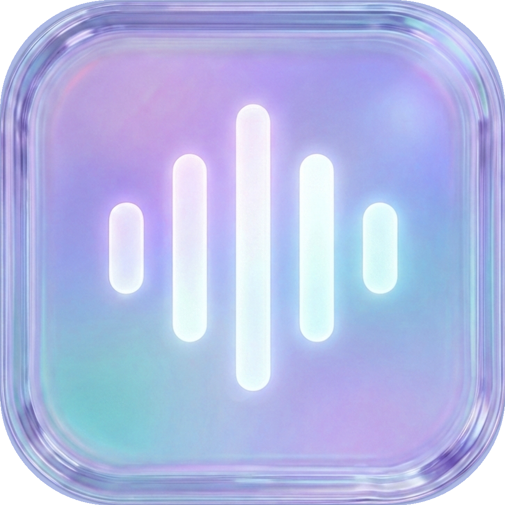

<p align="center">
  
</p>

<h1 align="center">KonradFlow</h1>

<p align="center">
  macOS dictation tuned for <strong>~150&nbsp;ms</strong> on the fast path — hold <code>Fn</code>, speak, release, paste once.
</p>

<p align="center">
  On-device models on Apple Silicon (local Julia 1 cleanup decisions) plus a Groq fallback when confidence is low.
</p>

---

## Overview

KonradFlow is a Wispr Flow–style dictation app for macOS built around **measurable latency**: warm capture on key-down, Groq Whisper for transcription, and **paste-light** cleanup that builds candidate sentences in code and lets a **local Julia 1** model pick the best one in a single decision (~33–50&nbsp;ms on M4-class hardware). Hard clips still use **Groq `gpt-oss-20b`** with the same prompt and vocabulary as before — one paste, never draft-and-replace.

**Design goal:** sub–200&nbsp;ms from release to paste on typical dictations when Julia accepts the winner; full cloud cleanup only when needed.

## Latency stack

| Stage | What happens |
|--------|----------------|
| **Fn down** | Start sound, start a pre-built (stopped) capture session — target **15–30&nbsp;ms** to first buffer |
| **Fn release** | `whisper-large-v3` via Groq |
| **Paste-light** | ≤20 candidate sentences → one Julia 1 choice |
| **Fallback** | `gpt-oss-20b` cleanup if probability is below threshold |
| **Idle** | Tear down capture after ~45&nbsp;s so the mic icon turns off |

Traces: `~/Library/Application Support/KonradFlow Dev/latency-traces.jsonl`

```bash
./Scripts/latency-benchmark.sh
```

Paste-light setup: [`docs/julia-paste-light.md`](docs/julia-paste-light.md)

## Quick Start

```bash
git clone https://github.com/konradtabay/konradflow.git
cd konradflow
make
open "build/KonradFlow Dev.app"
```

1. Grant **Microphone** and **Accessibility** for **KonradFlow Dev**.
2. Add a **Groq API key** in Settings.
3. Optional: install Julia 1 for paste-light (see docs above).
4. Hold **Fn**, speak, release.

## Build

```bash
make              # KonradFlow Dev (ad-hoc sign)
make test
make clean
```

## Privacy

No KonradFlow server. Audio and text leave your Mac only for APIs you configure (Groq, optional OpenAI realtime).

## License & credits

MIT — see [LICENSE](LICENSE). Portions derive from [FreeFlow](https://github.com/zachlatta/freeflow); see [ACKNOWLEDGMENTS.md](ACKNOWLEDGMENTS.md).
